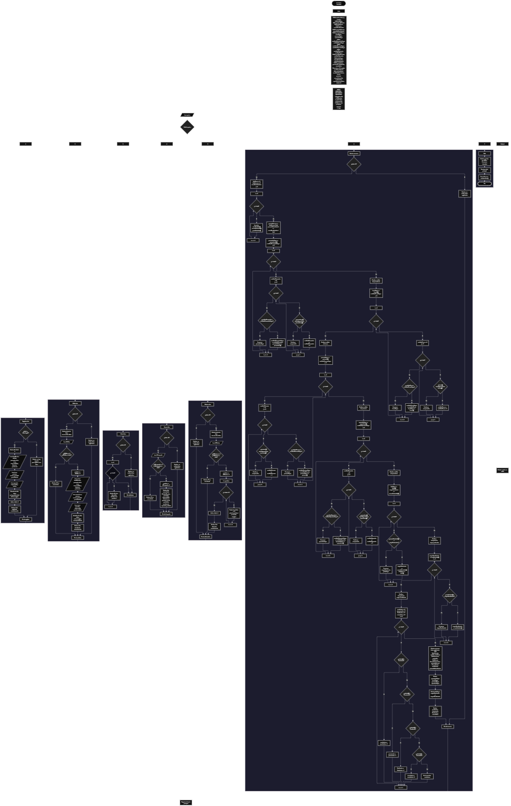

Este proyecto, llamado <b>azucarera industrial</b>, fue desarrollado en <b>java</b> como un ejercicio práctico para fortalecer la lógica de programación mediante la creación de un sistema de gestión de lotes de producción de azúcar desde la consola. El programa cuenta con un menú principal de siete opciones que permite <b>registrar, editar, eliminar, buscar, listar y consultar el resumen</b> de los lotes registrados. Cada lote almacena datos como su identificación, proveedor de la caña, cantidad de caña recibida, fecha de producción, turno, proceso, cantidad de azúcar producida, rendimiento, operador responsable y estado, utilizando arreglos con una capacidad máxima de <b>10 lotes durante la ejecución</b>. Durante su desarrollo se aplicaron conceptos fundamentales de programación, como variables, arreglos, estructuras condicionales, ciclos repetitivos y estructuras de selección, además de procesos para buscar, modificar, eliminar y organizar registros. También se implementaron cálculos estadísticos para obtener totales, promedios, frecuencias y los valores máximos de producción y rendimiento. Este proyecto permite poner en práctica los conocimientos adquiridos en java y sirve como base para desarrollar sistemas de gestión más avanzados utilizando otros lenguajes y tecnologías.

<h2 align="center">⚙️ Funcionamiento del menú principal</h2>

### ➕ Registrar lote

La opción <b>1) registrar lote</b> permite almacenar un nuevo lote de producción en el sistema. Antes de realizar el registro, el programa comprueba que la cantidad de lotes almacenados sea menor que la capacidad máxima de los arreglos, utilizando la condición <b>total &gt;= lotes.length</b> para identificar si ya no existe espacio disponible. Si se alcanza el límite de <b>10 lotes</b>, muestra el mensaje <b>"no hay espacio para registrar mas lotes."</b> e impide agregar otro registro. Si existe espacio disponible, muestra el identificador generado mediante <b>total + 1</b> y solicita los datos correspondientes al lote: <b>identificación, proveedor de la caña, caña recibida, fecha de producción, turno, proceso, azúcar producida, rendimiento, operador responsable y estado</b>. Cada dato se almacena en la posición correspondiente de su respectivo arreglo. Finalmente, incrementa la variable <b>total</b> en uno y muestra el mensaje <b>"lote registrado correctamente."</b>.

### ✏️ Editar lote

La opción <b>2) editar lote</b> permite modificar la información de un lote registrado. Primero, el programa comprueba si existen lotes almacenados mediante la variable <b>total</b>. Si no hay registros, muestra el mensaje <b>"no existen lotes registrados."</b>. En caso contrario, presenta una lista con el identificador, la identificación del lote, el proveedor, la cantidad de caña recibida, la fecha, el turno, el proceso, la cantidad de azúcar producida, el rendimiento, el operador y el estado de cada registro. Después, solicita el identificador del lote que se desea editar y comprueba que esté dentro del rango permitido mediante la condición <b>idEditar &gt;= 1 &amp;&amp; idEditar &lt;= total</b>. Si la selección es válida, obtiene la posición correspondiente mediante <b>idEditar - 1</b> y solicita nuevamente los diez datos del lote, actualizando directamente los valores de los arreglos correspondientes. Finalmente, presenta el mensaje <b>"lote actualizado correctamente."</b>. Si el identificador seleccionado no corresponde a un lote registrado, muestra el mensaje <b>"ID no encontrada."</b>.

### 🗑️ Eliminar lote

La opción <b>5) eliminar lote</b> permite eliminar un lote registrado mediante su identificador. Antes de comenzar, el programa comprueba que existan lotes almacenados. Si no hay registros, muestra el mensaje <b>"no existen lotes registrados."</b>. Si existen lotes disponibles, presenta una lista con toda la información de cada uno. Después, solicita el identificador del lote que se desea eliminar y verifica que esté dentro del rango válido mediante la condición <b>idEliminar &gt;= 1 &amp;&amp; idEliminar &lt;= total</b>. Si el identificador es válido, obtiene su posición mediante <b>idEliminar - 1</b> y comienza el proceso de eliminación. Para mantener los registros organizados, utiliza un ciclo <b>for</b> controlado por la variable <b>i</b>, que desplaza una posición hacia la izquierda los datos de los lotes posteriores en los diez arreglos: <b>lotes, proveedores, canaRecibida, fechas, turnos, procesos, azucarProducida, rendimientos, operadores y estados</b>. Posteriormente, disminuye la variable <b>total</b> en uno y muestra el mensaje <b>"lote eliminado correctamente."</b>. Si el identificador seleccionado no corresponde a un lote registrado, presenta el mensaje <b>"ID no encontrada."</b>.

### 🔎 Buscar lote

La opción <b>4) buscar lote</b> permite localizar un lote mediante su identificador numérico. Primero, el programa comprueba si existen lotes registrados. Si no hay información almacenada, muestra el mensaje <b>"no existen lotes registrados."</b>. En caso contrario, solicita el identificador del lote que se desea buscar y comprueba que esté dentro del rango permitido mediante la condición <b>idBusqueda &gt;= 1 &amp;&amp; idBusqueda &lt;= total</b>. Si la selección es válida, calcula su posición utilizando <b>idBusqueda - 1</b> y muestra toda la información correspondiente al lote encontrado: <b>identificación, proveedor, caña recibida, fecha de producción, turno, proceso, azúcar producida, rendimiento, operador responsable y estado</b>. Si el identificador introducido no corresponde a ningún lote registrado, muestra el mensaje <b>"ID no encontrada."</b>. La búsqueda se realiza directamente mediante la posición obtenida a partir del identificador, sin utilizar un recorrido para comparar los registros.

### 📋 Listar lotes

La opción <b>3) listar lotes</b> permite visualizar todos los lotes registrados actualmente en el sistema. Antes de mostrar la información, el programa comprueba si la variable <b>total</b> es igual a cero. Si no existen registros, presenta el mensaje <b>"no existen lotes registrados."</b>. Si hay lotes disponibles, utiliza un ciclo <b>for</b> para recorrer los arreglos desde la primera posición hasta la cantidad total de registros almacenados. Durante el recorrido, muestra el identificador de cada lote, su identificación, proveedor, cantidad de caña recibida, fecha de producción, turno, proceso, cantidad de azúcar producida, rendimiento, operador responsable y estado. Esta función facilita consultar los registros existentes sin necesidad de buscar cada lote individualmente.

### 📊 Mostrar resumen

La opción <b>6) mostrar resumen</b> permite consultar información estadística sobre los lotes registrados y conocer diferentes aspectos de la producción industrial. Primero, el programa comprueba si existen lotes almacenados. Si no hay registros, muestra el mensaje <b>"no existen lotes registrados."</b>. En caso contrario, inicializa las variables <b>totalCana, totalAzucar y sumaRendimientos</b> en cero y utiliza un ciclo <b>for</b> para acumular las cantidades de caña recibida, azúcar producida y los rendimientos de todos los lotes. Después, calcula el <b>promedioAzucar</b> dividiendo el total de azúcar producida entre la cantidad de lotes registrados y obtiene el <b>promedioRendimiento</b> dividiendo la suma de los rendimientos entre el total de registros.

Posteriormente, realiza cuatro análisis de frecuencia mediante ciclos <b>for</b> anidados para identificar el <b>proveedor más utilizado, el turno más utilizado, el proceso más frecuente y el operador con más lotes</b>. Para estas comparaciones utiliza el método <b>equalsIgnoreCase()</b>, que permite comparar los textos sin distinguir entre mayúsculas y minúsculas. También recorre los registros para identificar el <b>lote con mayor producción</b> y la <b>mayor producción de azúcar</b>, comparando los valores almacenados en el arreglo <b>azucarProducida</b>. De manera independiente, obtiene el mayor rendimiento registrado mediante el arreglo <b>rendimientos</b>. Finalmente, utiliza variables contadoras para clasificar los lotes según sus estados: <b>pendiente, procesando, finalizado y cancelado</b>. Al terminar los cálculos, muestra el resumen con los totales, promedios, frecuencias, valores máximos y cantidades correspondientes a cada estado.

### 🚪 Salir del menú principal

La opción <b>7) salir</b> está destinada a finalizar la ejecución del programa y muestra el mensaje <b>"gracias por utilizar azucarera industrial."</b>. El menú principal se encuentra dentro de una estructura repetitiva <b>do-while</b>, que mantiene el programa en funcionamiento mientras la opción seleccionada sea diferente de <b>7</b>. Cuando el usuario selecciona esta opción, el ciclo termina y se ejecuta la instrucción <b>entrada.close()</b>, que cierra el objeto <b>Scanner</b> utilizado para capturar los datos introducidos desde la consola.

<h2 align="center">🧠 Temas aplicados en el proyecto</h2>

### 📦 Variables

En este proyecto se utilizan variables para almacenar la opción seleccionada en el menú, controlar la cantidad de lotes registrados, recorrer los arreglos, seleccionar los registros que se desean editar, buscar o eliminar y realizar los cálculos estadísticos del resumen. También se utilizan variables acumuladoras para obtener los totales y promedios de producción, contadores para determinar las frecuencias de los datos y variables auxiliares para identificar los valores máximos. Cada variable cumple una función específica dentro de las operaciones de gestión de lotes.

🔢 **Opcion:** Almacena la opción seleccionada por el usuario en el menú principal.

📊 **Total:** Controla la cantidad actual de lotes registrados.

🔄 **I:** Funciona como contador en los ciclos `for` y permite recorrer las posiciones de los arreglos.

🔁 **J:** Controla el recorrido interno de los ciclos anidados utilizados para comparar los proveedores, turnos, procesos y operadores.

📝 **IdEditar:** Almacena el identificador del lote que se desea modificar.

🔎 **IdBusqueda:** Almacena el identificador del lote que se desea buscar.

🗑️ **IdEliminar:** Almacena el identificador del lote que se desea eliminar.

📍 **Posicion:** Almacena el índice correspondiente al lote seleccionado mediante su identificador.

⚖️ **TotalCana:** Acumula la cantidad total de caña recibida en todos los lotes.

🏭 **TotalAzucar:** Acumula la cantidad total de azúcar producida.

📈 **SumaRendimientos:** Acumula los porcentajes de rendimiento de los lotes registrados.

📊 **PromedioAzucar:** Almacena el promedio de azúcar producida por lote.

📉 **PromedioRendimiento:** Almacena el promedio de rendimiento de los lotes registrados.

🔢 **CantidadProveedor, CantidadTurno, CantidadProceso y CantidadOperador:** Cuentan las coincidencias encontradas durante los análisis de frecuencia.

🏆 **ProveedorMayor, TurnoMayor, ProcesoMayor y OperadorMayor:** Almacenan los valores que presentan la mayor frecuencia en sus respectivos arreglos.

🥇 **LoteMayor:** Almacena la identificación del lote que presenta la mayor producción de azúcar.

📈 **MayorProduccion:** Almacena la mayor cantidad de azúcar producida entre los lotes registrados.

📊 **MayorRendimiento:** Almacena el porcentaje de rendimiento más alto encontrado.

📋 **Pendientes, Procesando, Finalizados y Cancelados:** Cuentan los lotes que corresponden a cada uno de los estados reconocidos por el programa.

### 🗃️ Arreglos

En este proyecto se utilizan diez arreglos paralelos relacionados con la información de cada lote de producción. Cada arreglo tiene una capacidad de <b>10 posiciones</b> y utiliza el mismo índice para representar los datos correspondientes a un mismo registro. Por ejemplo, la información de un lote almacenado en la posición <b>0</b> se encuentra distribuida entre <b>lotes[0], proveedores[0], canaRecibida[0], fechas[0], turnos[0], procesos[0], azucarProducida[0], rendimientos[0], operadores[0] y estados[0]</b>. Esta organización permite recorrer, buscar, modificar, mostrar, eliminar y calcular estadísticas de los lotes de manera ordenada.

📝 **Lotes[10]:** Almacena las identificaciones de los lotes registrados.

🏭 **Proveedores[10]:** Almacena los nombres de los proveedores de la caña.

⚖️ **CanaRecibida[10]:** Almacena las cantidades de caña recibida en toneladas.

📅 **Fechas[10]:** Almacena las fechas de producción de los lotes.

🕒 **Turnos[10]:** Almacena los turnos correspondientes a cada lote.

⚙️ **Procesos[10]:** Almacena los procesos de producción utilizados.

🍬 **AzucarProducida[10]:** Almacena las cantidades de azúcar producida en toneladas.

📈 **Rendimientos[10]:** Almacena los porcentajes de rendimiento de cada lote.

👷 **Operadores[10]:** Almacena los nombres de los operadores responsables.

📋 **Estados[10]:** Almacena los estados actuales de los lotes.

### 🔀 Estructuras condicionales

En este proyecto se utilizan las estructuras <b>if, else if y else</b> para comprobar si existen lotes registrados antes de ejecutar determinadas operaciones, controlar la capacidad máxima de los arreglos durante el registro, verificar que los identificadores seleccionados estén dentro del rango permitido y determinar los valores máximos durante los cálculos del resumen. También se utilizan para clasificar los lotes según sus estados, comparar las cantidades de producción y decidir si se deben actualizar los valores de mayor frecuencia. Estas condiciones permiten que el programa responda de manera diferente según la información almacenada y el resultado de cada operación.

### 🔄 Estructuras repetitivas

En este proyecto se utilizan los ciclos <b>for</b> y <b>do-while</b>. Los ciclos <b>for</b> permiten recorrer los arreglos para mostrar los lotes, acceder a sus datos y acumular los valores necesarios para calcular el resumen. También se utilizan ciclos <b>for</b> anidados para comparar los proveedores, turnos, procesos y operadores, contando las coincidencias de cada elemento. Durante la eliminación, un ciclo <b>for</b> desplaza los datos de los registros posteriores una posición hacia la izquierda. Por otro lado, el ciclo <b>do-while</b> mantiene activo el menú principal para que el usuario pueda ejecutar diferentes operaciones hasta seleccionar la opción de salida.

### 🎯 Estructura switch

El programa utiliza la estructura <b>switch</b> para evaluar el valor almacenado en la variable <b>opcion</b> y ejecutar el bloque de instrucciones correspondiente. Cada caso representa una operación específica del sistema: <b>registrar lote, editar lote, listar lotes, buscar lote, eliminar lote, mostrar resumen o salir</b>. También se utiliza el bloque <b>default</b> para mostrar el mensaje <b>"opcion no valida."</b> cuando el usuario introduce un número que no coincide con ninguna de las opciones definidas en el menú. De esta manera, las operaciones se encuentran organizadas dentro de una estructura de selección.

### 🔢 Dimensionamiento de arreglos

El programa utiliza la creación de arreglos mediante la instrucción <b>new</b> de java para establecer la capacidad de los espacios destinados a almacenar la información de los lotes. Se definieron <b>10 posiciones</b> para cada uno de los diez arreglos, utilizando tipos de datos <b>String</b> para la información textual y <b>double</b> para las cantidades y porcentajes numéricos. La cantidad de posiciones ocupadas se controla mediante la variable <b>total</b>, por lo que las operaciones recorren únicamente los registros comprendidos entre la primera posición y el total actual de lotes. Esta organización permite administrar hasta 10 lotes durante la ejecución del programa.

### 🔄 Reorganización de registros

Cuando se selecciona un lote para eliminarlo, el programa utiliza un ciclo <b>for</b> que comienza en la posición seleccionada y continúa mientras <b>i &lt; total - 1</b>. En cada repetición, los datos de la posición siguiente se copian sobre la posición actual en los diez arreglos: <b>lotes, proveedores, canaRecibida, fechas, turnos, procesos, azucarProducida, rendimientos, operadores y estados</b>. Después, la variable <b>total</b> disminuye en uno. De esta manera, los lotes posteriores ocupan las posiciones disponibles y los registros activos permanecen organizados sin espacios intermedios. La última posición no se limpia explícitamente, pero deja de formar parte de los registros activos porque el contador disminuye.

<h2 align="center">¿Cómo se implementaron las operaciones crud en el proyecto?</h2>

Las operaciones <b>crud</b> se implementaron mediante las opciones del menú principal, permitiendo administrar los lotes de producción registrados. La operación <b>crear</b> corresponde a <b>registrar lote</b>, donde se introducen los diez datos de un nuevo registro; <b>leer</b> se realiza mediante las opciones <b>buscar lote, listar lotes y mostrar resumen</b>, que permiten consultar la información almacenada y sus estadísticas; <b>actualizar</b> corresponde a <b>editar lote</b>, donde se modifican los datos de un lote existente; y <b>eliminar</b> se realiza mediante la opción <b>eliminar lote</b>, que retira un registro y reorganiza los datos de los arreglos. Estas operaciones utilizan variables, arreglos, condicionales y ciclos para gestionar la información almacenada temporalmente durante la ejecución del programa.

<h2 align="center">Diagrama de flujo del proyecto</h2>

<h2 align="center">🛡️ Validaciones del programa</h2>

### 📭 No existen lotes registrados

Esta validación se utiliza en las opciones de <b>editar, listar, buscar, eliminar y mostrar resumen</b>. El programa comprueba si la variable <b>total</b> es igual a <b>0</b> y, si no existen lotes registrados, muestra el mensaje <b>"no existen lotes registrados."</b>. Esta comprobación evita continuar con las operaciones que necesitan información almacenada cuando no hay registros disponibles.

### ⚠️ Capacidad máxima de lotes

Esta validación se utiliza durante el registro de nuevos lotes para controlar la capacidad máxima de los arreglos. El programa comprueba si <b>total &gt;= lotes.length</b> antes de permitir agregar un nuevo registro. Si existe espacio disponible, solicita los datos del lote y aumenta el contador <b>total</b> en uno. En caso contrario, muestra el mensaje <b>"no hay espacio para registrar mas lotes."</b>, impidiendo registrar más información cuando se alcanza la capacidad máxima de 10 posiciones.

### ❌ Lote no encontrado

Esta validación se utiliza durante las operaciones de <b>editar, buscar y eliminar</b>. El programa solicita el identificador del lote y comprueba que esté dentro del rango permitido mediante las condiciones <b>id &gt;= 1</b> e <b>id &lt;= total</b>, utilizando la variable correspondiente a cada operación. Si el identificador se encuentra dentro del rango, obtiene la posición mediante la resta de uno y ejecuta la operación solicitada. Si el valor introducido no corresponde a un lote registrado, muestra el mensaje <b>"ID no encontrada."</b>. Esta comprobación evita acceder a posiciones que no corresponden a registros activos.

### 🔢 Comparación de registros

El programa utiliza el método <b>equalsIgnoreCase()</b> durante los análisis de frecuencia del resumen para comparar los nombres de los proveedores, turnos, procesos y operadores sin distinguir entre mayúsculas y minúsculas. También utiliza este método para clasificar los lotes según los estados <b>"Pendiente", "Procesando", "Finalizado" y "Cancelado"</b>. Si un estado no coincide con ninguno de estos valores, no se incrementa ninguno de los contadores definidos para la clasificación.

### ⚠️ Opción inválida

La estructura <b>switch</b> incluye el bloque <b>default</b>, que muestra el mensaje <b>"opcion no valida."</b> cuando el usuario introduce un número que no corresponde a ninguna de las siete opciones definidas en el menú. Esta condición permite informar al usuario cuando selecciona una operación que no está disponible en el sistema.

<h2 align="center">🎯 Objetivo del proyecto</h2>

El objetivo principal de este proyecto es fortalecer la <b>lógica de programación</b> mediante el desarrollo de un sistema de gestión de lotes de producción de azúcar en <b>java</b>. A través de su construcción se busca aplicar los conocimientos adquiridos sobre variables, arreglos, estructuras condicionales, ciclos repetitivos y estructuras de selección, integrándolos para resolver un problema de manera organizada. Además, el proyecto permite comprender cómo registrar, consultar, modificar y eliminar información mediante arreglos paralelos, así como realizar cálculos estadísticos para analizar la producción, los rendimientos y los estados de los lotes. De esta manera, se establece una base para desarrollar sistemas de gestión más completos utilizando otros lenguajes y tecnologías.

